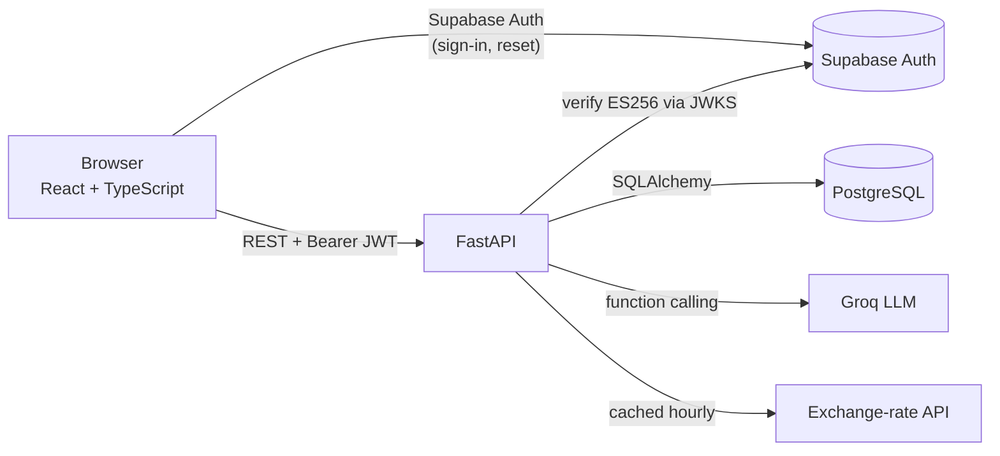

# PawPurse 🐾

[](https://github.com/HienThong-vie/pawpurse/actions/workflows/ci.yml)

**A personal finance tracker with an AI advisor that can act on your data, and a pet companion that rewards you for staying under budget.**

**Live demo:** https://pawpurse.vercel.app

<!-- Screenshots: add images to docs/screenshots/ and reference them here, e.g.
 -->

## Features

- **Transactions**: income and expenses with categories, notes, custom emoji per category, and recurring entries (daily, weekly, monthly).
- **Budgets**: per-category limits by day, week or month, with live spending progress and four status levels (acceptable, caution, warning, exceeded).
- **Savings goals**: target amounts, deadlines, quick-add progress and undo.
- **Multi-currency**: everything is stored in the currency it was entered in and converted to your base currency when read, using cached exchange rates.
- **AI advisor**: a chat assistant (Llama 3.3 70B on Groq) that sees a summary of your finances and can **create transactions, budgets and goals** through function calling ("I spent 12 on lunch" records an expense).
- **Pet companion**: pick a cat or dog during onboarding. Leftover budget at the end of each period earns coins, which you spend on beds in a shop.
- **Dashboard**: monthly trend chart, spending breakdown, recent activity and in-app notifications.
- **Export** to CSV and PDF. **6 languages** (English, Tiếng Việt, 中文, 日本語, 한국어, हिन्दी). **Dark mode.** Responsive down to mobile.

## Architecture



- **Frontend:** React 19, TypeScript, Vite, Tailwind CSS v4, React Router, Recharts, i18next. Deployed on **Vercel**.
- **Backend:** FastAPI, SQLAlchemy 2, Pydantic 2 and PostgreSQL. Deployed on **Railway**.
- **Auth:** Supabase Auth issues the tokens. The API verifies every token's ES256 signature and audience against Supabase's public JWKS, then scopes every query to the user ID taken from the token. Client-supplied user IDs are never trusted.

## Engineering highlights

- **Stateless JWT verification.** Signing keys are cached at startup and refetched, rate-limited, when an unknown key ID appears, so key rotation doesn't require a restart.
- **Reliable LLM tool use.** If Groq rejects a request because the model called a nonexistent tool or passed malformed arguments, the advisor retries once without tools so the user still gets an answer. It also catches tool calls the model writes as plain text instead of making them: it executes the action and asks the model for a natural confirmation. Every argument the model supplies is validated before anything touches the database.
- **Token-efficient prompts.** Instead of raw rows, the advisor gets per-category totals plus the 5 most recent transactions. History is capped per request to stay inside the shared daily token budget.
- **Game economy with server-side rewards.** Coins are calculated only on the server. A unique `(user, budget, period)` constraint makes each reward idempotent, even under concurrent requests.
- **Per-user rate limiting.** Authenticated routes are limited by user ID, so users behind a shared proxy don't share one bucket.
- **Display conversion never touches stored data.** Reads build fresh response objects, and a regression test guards against converted amounts being written back.

## Project structure

```
backend/
  main.py            FastAPI app, CORS, router registration
  core/              auth (JWKS), DB session, currency, rate limiter, recurring job
  models/            SQLAlchemy models
  schemas/           Pydantic request/response models (validation lives here)
  routers/           transactions, budgets, goals, categories, advisor, mascot, ...
  tests/             pytest suite (SQLite + locally signed ES256 tokens)
frontend/
  src/pages/         route-level pages (Dashboard, Transactions, Budget, Goals, Advisor, ...)
  src/components/    layout, setup wizard, notifications, mascot widget
  src/context/       auth, theme, toast, confirm-dialog, notification providers
  src/lib/           API client, shared types, hooks, helpers
  src/i18n/          translation files
```

## Running locally

**Prerequisites:** Python 3.13, Node 22+, PostgreSQL, a Supabase project, and API keys for [Groq](https://console.groq.com) and [ExchangeRate-API](https://www.exchangerate-api.com).

```bash
# Backend (from backend/ — imports are relative to this folder)
cd backend
python -m venv venv
source venv/bin/activate          # Windows: venv\Scripts\activate
pip install -r requirements.txt
cp .env.example .env              # fill in the values
uvicorn main:app --reload --port 8000
```

```bash
# Frontend
cd frontend
npm install
cp .env.example .env              # fill in the values
npm run dev                       # http://localhost:5173
```

Tables are created automatically on first start.

**Demo data:** `DEMO_PASSWORD=... python scripts/seed_demo.py --email demo@pawpurse.app` (from `backend/`) creates a confirmed demo user with onboarding already done and three months of sample transactions, budgets, goals and a companion. Re-running it resets the account. Set the printed `DEMO_USER_ID` on the backend so visitors can't delete it.

## Testing

```bash
cd backend && pip install -r requirements-dev.txt && pytest
cd frontend && npm run lint && npm run build
```

The backend suite runs without network access or Postgres. It uses in-memory SQLite and signs real ES256 tokens with a locally generated key, so the actual verification path is exercised. It covers forged and foreign tokens, cross-user isolation, ignoring client-supplied user IDs, currency-conversion integrity, recurring transactions, coin rewards and account deletion. CI runs both the backend tests and the frontend lint and build on every push and pull request.
